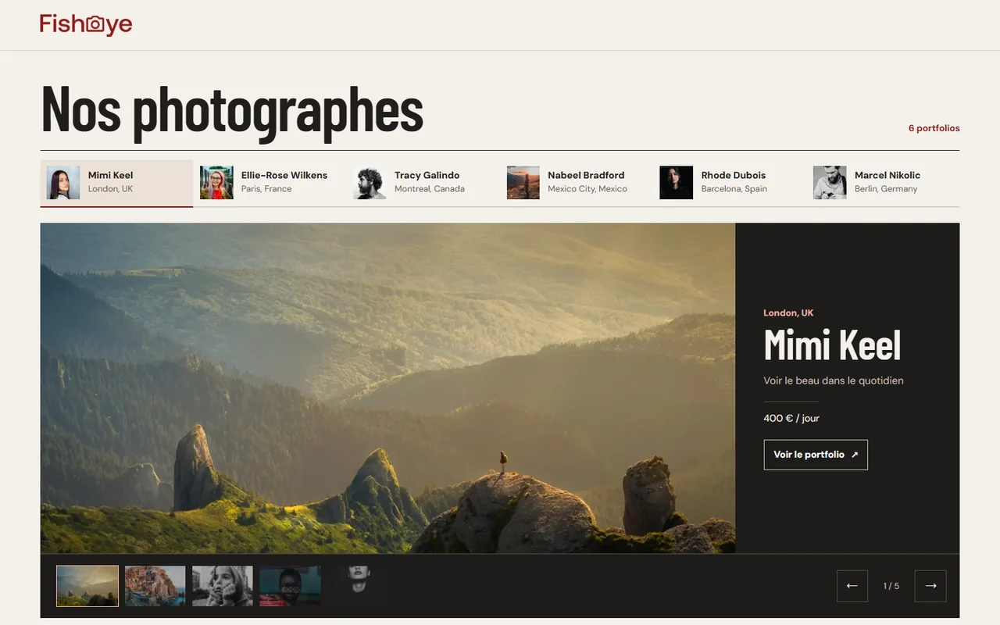

# FishEye

J’ai développé ce site pour le parcours front-end d’OpenClassrooms. On peut parcourir six portfolios, trier les photos et vidéos, ouvrir un média en plein écran et tester le formulaire de contact.

[Voir la démo GitHub Pages](https://drgyz.github.io/Front-End-Fisheye-main/)



[Voir une page portfolio](docs/screenshots/portfolio.webp)

## Lancer le projet

Le site utilise HTML, CSS et JavaScript. Il peut être servi directement depuis la racine du dépôt.

```sh
python -m http.server 5173 --bind 127.0.0.1
```

Ouvrez [localhost:5173](http://localhost:5173). Pour lancer ESLint et vérifier les chemins des fichiers du catalogue, utilisez Node.js 24.

```sh
npm ci
npm run verify
```

## Dans le code

- Dans l’annuaire, chaque photographe a une sélection de photos. On peut la parcourir avec les miniatures, les flèches ou en glissant sur l’image. Les miniatures WebP ont leur propre taille pour éviter de charger les grandes images à l’avance.
- La galerie plein écran et le formulaire utilisent des boîtes de dialogue natives. La galerie se parcourt avec les flèches ou les miniatures. Les photos plein écran et les vidéos se chargent à l’ouverture du média.
- Les mentions J’aime sont conservées pendant le tri. Vos ajouts disparaissent au rechargement. Le formulaire valide les champs dans le navigateur.

Le catalogue se trouve dans `data/photographers.json`. Les pages et interactions sont dans `scripts/`, les aperçus dans `assets/previews/` et les fichiers plein écran dans `assets/photographers/`.
